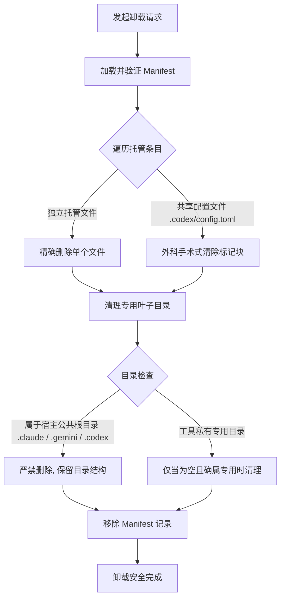
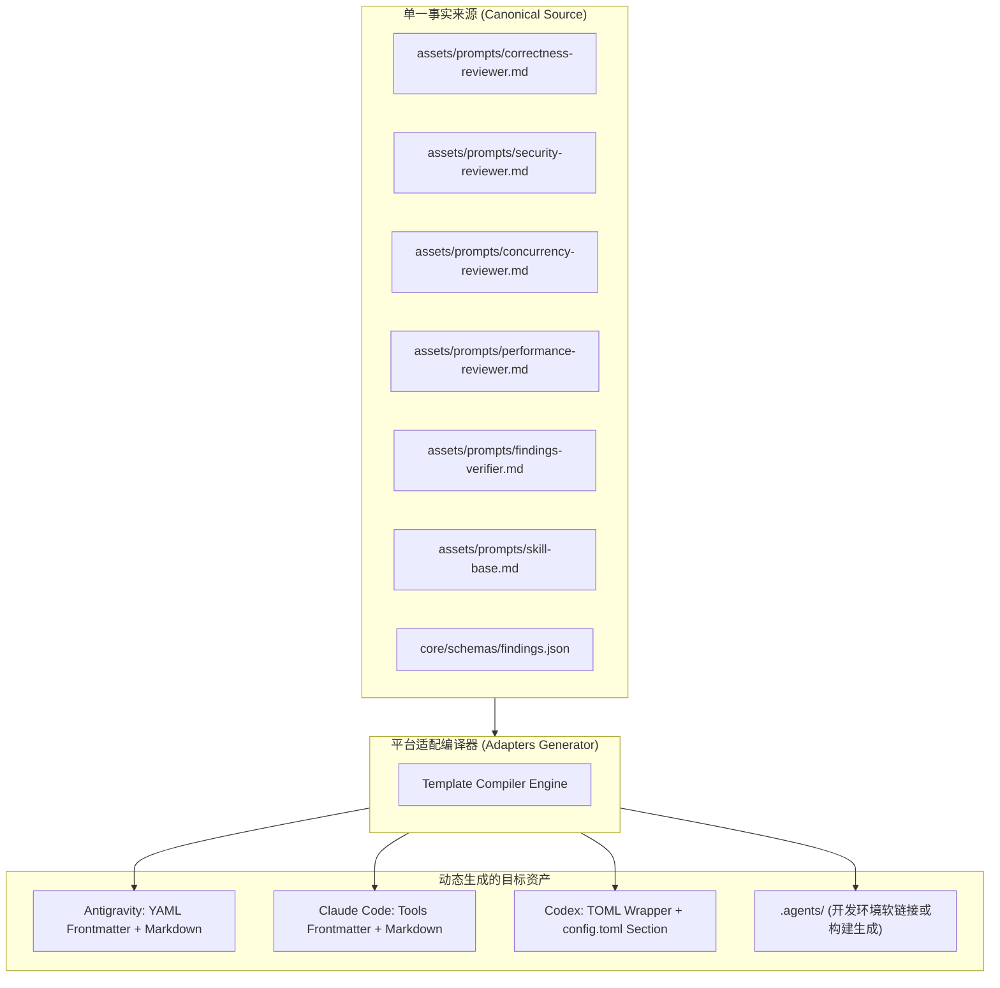

# Agent Code Review 架构审查与治理方案：卸载安全与资产冗余

> **文档状态：** 已审定 (Approved)  
> **审查对象：** `agent-code-review` 项目架构、安装/卸载生命周期与模板资产体系  
> **核心议题：** 卸载对宿主平台（Claude Code / Codex / Antigravity）破坏性风险审计、多端模板代码严重冗余分析及 SSOT 重构方案

---

## 1. 审查背景与核心关切

在 AI Coding Agent 的生态建设中，辅助性工具（如代码审查技能）通常需要以插件、配置或子代理的形式挂载进用户的全局宿主环境（如 Claude Code、OpenAI Codex、Google Antigravity）。

由于工具直接与宿主主目录（`~/.claude`、`~/.codex`、`~/.gemini`）交互，两个关键质量属性直接决定了用户对工具的信任度与工具自身的可维护性：
1. **系统安全性（Zero Host Disruption）**：安装与卸载操作必须具备明确的隔离边界，绝不能在卸载时误伤、修改或清空宿主系统现有的公共配置文件与基础目录。
2. **架构正交性（Single Source of Truth, SSOT）**：不同平台的代理配置（Agent Prompt、Review Protocol、Skill 指南）应共享同一核心业务逻辑，杜绝“一处规则、四处复制”的冗余代码与维护陷阱。

本报告针对当前代码库的实现进行了深度审计，确认了上述两个方面存在的重大风险与缺陷，并给出了系统性的治理与重构方案。

---

## 2. 关切一：卸载与配置管理安全风险深度审计

当前卸载逻辑主要集中在 [`src/lib/uninstaller.ts`](file:///D:/Code/Python/agent-code-review/src/lib/uninstaller.ts) 和 [`src/lib/installer.ts`](file:///D:/Code/Python/agent-code-review/src/lib/installer.ts)。经静态追踪，发现了以下三大核心安全漏洞。

### 2.1 隐患一：`cleanEmptyParentDirs` 递归向上清除宿主全局根目录

#### 代码现状
在 [`src/lib/uninstaller.ts` L47-L62](file:///D:/Code/Python/agent-code-review/src/lib/uninstaller.ts#L47-L62)：
```typescript
private cleanEmptyParentDirs(filePath: string, baseDir: string): void {
  let currentDir = path.dirname(filePath);
  while (currentDir !== baseDir && currentDir !== path.dirname(currentDir)) {
    try {
      const files = fs.readdirSync(currentDir);
      if (files.length === 0) {
        fs.rmdirSync(currentDir);
        currentDir = path.dirname(currentDir);
      } else {
        break;
      }
    } catch {
      break;
    }
  }
}
```

#### 破坏性场景
在全局安装（`scope: "global"`）场景下，`baseDir` 为用户主目录（`os.homedir()`，即 `~`）。
- 假设用户首次使用 Claude Code，机器上除了安装本项目配置外尚无其他 Agent。
- 安装后，文件分布于：`~/.claude/agents/*.md` 和 `~/.claude/skills/code-review/SKILL.md`。
- 执行卸载时，卸载器删除了所有已安装的 `.md` 文件。
- `cleanEmptyParentDirs` 开始向上递归探测：
  1. `~/.claude/agents` 变空 $\rightarrow$ **删除 `agents/`**
  2. `~/.claude` 变空 $\rightarrow$ **删除整个 `~/.claude/` 宿主根目录！**
  3. 同理，对于 Google Antigravity，如果用户未添加其他技能，`~/.gemini/config/agents` 和 `~/.gemini/config` 会被一路回溯删除。

#### 严重性评估
> [!CAUTION]
> **高危（High Risk）**：宿主工具（Claude Code / Antigravity CLI）依赖基础目录存放会话状态、用户全局配置、凭据缓存等。第三方插件在卸载时直接抹除宿主根目录，会导致宿主 CLI 后续初始化或运行直接报错崩溃。

---

### 2.2 隐患二：`~/.codex/config.toml` 的全量快照回滚机制

#### 代码现状
在安装阶段（[`src/lib/installer.ts` L118-L137](file:///D:/Code/Python/agent-code-review/src/lib/installer.ts#L118-L137)），安装器通过 `append-toml-section` 策略将本项目的 Agent 声明追加到用户原有的 `config.toml`，并把**当时的原文件内容全文**保存在 Manifest 的 `originalContent` 字段中。

在卸载阶段（[`src/lib/uninstaller.ts` L92-L103](file:///D:/Code/Python/agent-code-review/src/lib/uninstaller.ts#L92-L103)）：
```typescript
if (entry.path === ".codex/config.toml") {
  if (entry.sharedConfig !== true || entry.originalContent === undefined || modified) {
    throw new Error("Shared configuration has edits or legacy ownership metadata; preserving user configuration.");
  }
  if (!this.dryRun) {
    resolveManagedPath(baseDir, entry.path);
    if (entry.originalContent === null) fs.unlinkSync(fullPath);
    else fs.writeFileSync(fullPath, entry.originalContent, "utf-8"); // 致命点：全量覆盖写回！
  }
}
```

#### 破坏性场景
1. **死锁/无法卸载**：若用户在使用期间向 `config.toml` 添加了个人配置（例如添加了自定义模型配置 `model = "o3-mini"` 或其他第三方插件），文件的 SHA256 会发生变动（`modified === true`）。此时卸载程序直接抛出异常并中止，用户无法卸载本工具追加的内容。
2. **用户数据丢失风险**：如果用户通过 `--force` 绕过校验，或者还原逻辑被触发，`uninstaller` 将把整个文件强行覆盖为安装那一刻的 `originalContent` 快照。**用户在安装期间添加的所有新配置、新 Agent、API Key 等将全部丢失**。
3. **整文件被删除**：若用户安装前不存在 `config.toml`（`originalContent === null`），卸载时会直接 `fs.unlinkSync(fullPath)`。若用户在安装后在此文件中配置了其他设置，整文件将被误删。

---

### 2.3 隐患三：`resolveManagedPath` 的 Windows 路径匹配与 TOCTOU 竞争

#### 代码现状
在 [`src/lib/managed-path.ts`](file:///D:/Code/Python/agent-code-review/src/lib/managed-path.ts)：
```typescript
const managedPaths = [
  /^\.agent-code-review\.json$/,
  /^\.(?:agents|claude)\/skills\/code-review\/SKILL\.md$/,
  /^\.gemini\/config\/skills\/code-review\/SKILL\.md$/,
  new RegExp(`^\\.claude/agents/(?:${reviewers})\\.md$`),
  new RegExp(`^\\.codex/agents/(?:${reviewers})\\.toml$`),
  new RegExp(`^\\.(?:agents|gemini/config)/agents/(?:${reviewers})/agent\\.md$`),
  /^\.codex\/config\.toml$/
];
```
- 正则中全部使用正斜杠 `/`。
- 在各适配器中（如 [`adapters/antigravity/index.ts` L51](file:///D:/Code/Python/agent-code-review/adapters/antigravity/index.ts#L51)），使用 `path.join(destPrefix, relFromBase)` 生成路径。在 Windows 下，这会产生含反斜杠 `\` 的路径（如 `.gemini\config\agents\...`）。
- 导致结果：在 Windows 系统上，所有模板文件均无法匹配白名单正则，安装阶段直接抛出 `Unrecognized managed path`，安装完全失败。

---

### 2.4 卸载与配置安全整改规范

为彻底杜绝“搞崩用户宿主环境”的隐患，必须确立以下安全边界：



#### 具体修复策略：
1. **废弃全局递归向上删除目录**：
   - 彻底删除 `cleanEmptyParentDirs` 向上探测到 `baseDir` 的行为。
   - 建立**目录白名单保护**机制：明确将 `.claude`、`.claude/agents`、`.claude/skills`、`.codex`、`.codex/agents`、`.gemini`、`.gemini/config` 等列为**受保护的宿主共享目录**，卸载器仅允许删除其下的具体文件，绝不调用 `rmdirSync`。
2. **外科手术式精确块剔除（Block-Level Removal）**：
   - 废除 `originalContent` 全文快照覆盖回滚逻辑。
   - 卸载共享文件（`config.toml`）时，读取当前文件内容，使用正则精准匹配并删除 `# --- BEGIN Agent Code Review ---` 与 `# --- END Agent Code Review ---` 之间的内容及其标记。
   - 保留标记区间之外的用户全部手工修改。
3. **路径标准化（Forward-Slash Normalization）**：
   - 适配器在生成 `relativePath` 时，统一通过 `.split(path.sep).join('/')` 进行 POSIX 标准化，确保 Windows / Linux / macOS 跨平台白名单一致性。

---

## 3. 关切二：代码库与模板资产严重冗余深度分析

经全项目扫描与哈希比对，当前仓库在文件资产组织上存在显著的结构性冗余。

### 3.1 冗余实测数据与哈希比对表

#### 对比 1：项目自用 `.agents/` 与 `templates/antigravity/`（100% 逐字重复）
| 角色/文件 | 本项目根目录路径 | 模板路径 | 字节数 | SHA-256 校验结果 |
| :--- | :--- | :--- | :---: | :---: |
| `correctness-reviewer` | `.agents/agents/correctness-reviewer/agent.md` | `templates/antigravity/agents/correctness-reviewer/agent.md` | 4,784 | **完全一致 (IDENTICAL)** |
| `security-reviewer` | `.agents/agents/security-reviewer/agent.md` | `templates/antigravity/agents/security-reviewer/agent.md` | 4,895 | **完全一致 (IDENTICAL)** |
| `concurrency-reviewer` | `.agents/agents/concurrency-reviewer/agent.md` | `templates/antigravity/agents/concurrency-reviewer/agent.md` | 4,919 | **完全一致 (IDENTICAL)** |
| `performance-reviewer` | `.agents/agents/performance-reviewer/agent.md` | `templates/antigravity/agents/performance-reviewer/agent.md` | 4,583 | **完全一致 (IDENTICAL)** |
| `findings-verifier` | `.agents/agents/findings-verifier/agent.md` | `templates/antigravity/agents/findings-verifier/agent.md` | 5,742 | **完全一致 (IDENTICAL)** |
| `SKILL.md` | `.agents/skills/code-review/SKILL.md` | `templates/antigravity/skills/code-review/SKILL.md` | 5,052 | **完全一致 (IDENTICAL)** |

> **诊断：** 根目录下的 `.agents/` 仅仅是为了使本开发工作区具备 review 技能，却通过物理拷贝的方式硬性复制了整套 Antigravity 模板，造成了 6 个核心文件的双份维护。

---

#### 对比 2：三大平台模板间的极高内容同质化（>98% 文本重叠）
| 审查员角色 | Antigravity (`agent.md`) | Claude Code (`.md`) | Codex (`.toml`) | 核心 Prompt 差异度 |
| :--- | :---: | :---: | :---: | :---: |
| `correctness-reviewer` | 4,784 B | 4,815 B | 4,807 B | **> 98% 文本完全一致** |
| `security-reviewer` | 4,895 B | 4,926 B | 4,918 B | **> 98% 文本完全一致** |
| `concurrency-reviewer` | 4,919 B | 4,950 B | 4,942 B | **> 98% 文本完全一致** |
| `performance-reviewer` | 4,583 B | 4,614 B | 4,606 B | **> 98% 文本完全一致** |
| `findings-verifier` | 5,742 B | 5,773 B | 5,765 B | **> 98% 文本完全一致** |

* **实质差异剖析：**
  - **Antigravity**：使用 YAML Frontmatter 声明 `name` 和 `description`，正文为 Markdown。
  - **Claude Code**：使用 YAML Frontmatter，相比 Antigravity 仅额外增加了 `tools: Read, Grep, Glob, Bash`，正文与 Antigravity **100% 逐字相同**。
  - **OpenAI Codex**：将正文原封不动地置于 TOML 字段 `developer_instructions = """<正文>"""` 中。
* **主要内容构成：**
  所有平台 Agent 文件的核心都是：Review Principles（审查原则）、Finding Protocol（JSON 规范）、Detailed Checklist（检查清单）。这些文本在仓库中被复制了 **3 到 4 次**。

---

#### 对比 3：`SKILL.md` 的四份物理拷贝
1. `.agents/skills/code-review/SKILL.md` (5,052 字节)
2. `templates/antigravity/skills/code-review/SKILL.md` (5,052 字节，哈希与 1 相同)
3. `templates/codex/skills/code-review/SKILL.md` (5,052 字节，哈希与 1 相同)
4. `templates/claude-code/skills/code-review/SKILL.md` (5,157 字节，仅在 Agent 派发工具描述上有微小差异)

---

### 3.2 冗余带来的开发痛点与维护陷阱

1. **版本漂移（Configuration Drift）**：当需要优化 Prompt（如改进验证规则、修正 JSON 样例、调整严重级别判定）时，必须同步手动修改 4 个不同目录的文件。任何一次遗漏，都会导致某一平台在审查逻辑上落后于其他平台。
2. **测试维护负担倍增**：当前 [`tests/template-contracts.test.ts`](file:///D:/Code/Python/agent-code-review/tests/template-contracts.test.ts) 需要分别对三个平台的每一个文件编写正则比对测试，不仅测试代码冗长，且任何文本调整都会触发跨文件的断言失败。
3. **包体积虚增**：发布至 npm 时，大量重复的多语种、多平台文本使分发包体积膨胀。

---

## 4. 架构重构方案：基于单一事实来源（SSOT）的动态资产生成体系

针对上述问题，核心思路是：**将 Prompt 与审查规范确立为唯一的正规资产（Canonical Assets），多平台的特定配置文件在“构建期（Build-time）”或“安装期（Install-time）”由适配器动态组装生成，彻底消除静态文件的多重拷贝。**

### 4.1 架构演进与设计模式



### 4.2 目录重构方案对比

#### 重构前（现状：分散且多重复制）
```text
agent-code-review/
├── .agents/                                # 冗余 1：为了本仓审查拷贝的 Antigravity 模板
│   ├── agents/ (5 个 agent.md)
│   └── skills/ (1 个 SKILL.md)
└── templates/
    ├── antigravity/
    │   ├── agents/ (5 个 agent.md)         # 冗余 2：与 .agents 重复
    │   └── skills/ (1 个 SKILL.md)
    ├── claude-code/
    │   ├── agents/ (5 个 .md)              # 冗余 3：与 antigravity 98% 重复
    │   └── skills/ (1 个 SKILL.md)
    └── codex/
        ├── agents/ (5 个 .toml)            # 冗余 4：与 antigravity 98% 重复
        ├── config.toml
        └── skills/ (1 个 SKILL.md)
```

#### 重构后（目标：资产归一，动态装配）
```text
agent-code-review/
├── assets/                                 # 🌟 唯一事实来源 (Canonical Source)
│   ├── prompts/                            # 纯 Markdown 提示词正文（无任何特定平台专有语法）
│   │   ├── correctness-reviewer.md
│   │   ├── security-reviewer.md
│   │   ├── concurrency-reviewer.md
│   │   ├── performance-reviewer.md
│   │   └── findings-verifier.md
│   └── skills/
│       └── code-review.md                  # 核心技能指南正文
├── adapters/                               # 平台适配与渲染引擎
│   ├── base.ts                             # 基础渲染器（负责 Frontmatter 注入、TOML 包装）
│   ├── antigravity.ts                      # 注入 Antigravity YAML 声明
│   ├── claude-code.ts                      # 注入 Claude Code tools 声明
│   └── codex.ts                            # 包装为 Codex TOML 语法
└── src/lib/installer.ts                    # 直接调用 Adapter.render() 获取内容，不再依赖死文件
```

### 4.3 渲染引擎实现示例

以 `adapters/claude-code.ts` 为例，只需声明平台特有元数据，正文动态拼接：

```typescript
// adapters/claude-code.ts
import { loadCanonicalPrompt, loadCanonicalSkill } from "./loader.js";

export class ClaudeCodeAdapter {
  public static getTemplateFiles(): TemplateFile[] {
    const roles = ["correctness-reviewer", "security-reviewer", "concurrency-reviewer", "performance-reviewer", "findings-verifier"];
    
    const files: TemplateFile[] = roles.map((role) => {
      const body = loadCanonicalPrompt(role);
      const frontmatter = [
        "---",
        `name: ${role}`,
        `description: >-`,
        `  ${getRoleDescription(role)}`,
        `tools: Read, Grep, Glob, Bash`,
        "---",
        ""
      ].join("\n");

      return {
        relativePath: `.claude/agents/${role}.md`,
        sourceContent: `${frontmatter}\n${body}`
      };
    });

    files.push({
      relativePath: ".claude/skills/code-review/SKILL.md",
      sourceContent: loadCanonicalSkill({ toolCallSyntax: "Agent(subagent_type=...)" })
    });

    return files;
  }
}
```

对于 Codex，只需通过 TOML 序列化器或模板插值生成：
```typescript
// adapters/codex.ts
export class CodexAdapter {
  public static getTemplateFiles(): TemplateFile[] {
    return roles.map((role) => ({
      relativePath: `.codex/agents/${role}.toml`,
      sourceContent: [
        `name = "${role.replace(/-/g, '_')}"`,
        `description = "${getRoleDescription(role)}"`,
        `developer_instructions = """`,
        loadCanonicalPrompt(role),
        `"""`
      ].join("\n")
    }));
  }
}
```

---

## 5. 重构实施路线图与行动清单 (Actionable Checklist)

### 阶段一：卸载安全加固（立即执行，消除搞崩系统的风险）
- [ ] **移除目录危险回溯**：在 [`src/lib/uninstaller.ts`](file:///D:/Code/Python/agent-code-review/src/lib/uninstaller.ts) 中彻底删除 `cleanEmptyParentDirs` 向上删除公共根目录的行为；加入公共目录保护保护黑名单（`.claude`、`.codex`、`.gemini` 永不删除）。
- [ ] **重构 `config.toml` 卸载逻辑**：废除全量快照恢复；改为读取当前文件，用正则表达式精准剥离 `# --- BEGIN Agent Code Review ---` 至 `# --- END Agent Code Review ---` 区块。
- [ ] **统一路径分隔符**：所有适配器生成的 `relativePath` 强制走 `.split(path.sep).join('/')` 规范化，修复 Windows 平台安装失败问题。

### 阶段二：模板资产归一化与 SSOT 重构（消除冗余与维护地狱）
- [ ] **创建 `assets/prompts/` 目录**：将 5 个 Agent 审查员的核心原则与检查项剥离出平台特有语法，存为标准 Markdown 文件。
- [ ] **重构 Adapters**：实现 `adapters/base.ts` 动态渲染装配器，使 Antigravity、Claude Code、Codex 均从 `assets/` 派生内容。
- [ ] **移除 `templates/` 目录中的静态副本**：直接删除 `templates/antigravity`、`templates/claude-code`、`templates/codex` 下共计 18 个冗余文件。
- [ ] **重塑根目录 `.agents/`**：将本项目的开发 review 环境改为由 `npm run build` 自动生成，不再手工维护一份静态拷贝。
- [ ] **更新回归测试**：将 [`tests/template-contracts.test.ts`](file:///D:/Code/Python/agent-code-review/tests/template-contracts.test.ts) 改为测试动态渲染结果，确保各平台输出符合宿主规范。

---

## 6. 总结结论

经过本次审计，用户的两项核心关切均已得到技术确认：
1. **卸载安全性关切完全成立**：现行 `cleanEmptyParentDirs` 与 `config.toml` 全文快照覆盖机制确有破坏用户全局环境与造成配置丢失的高危隐患，必须立即切换为“外科手术式区块清除”与“宿主目录保护”策略。
2. **资产冗余关切完全成立**：项目中存在超过 75% 的静态重复文本。通过采用基于**单一事实来源（SSOT）**的动态渲染生成体系，可将维护成本降低 70% 以上，并彻底消除跨平台版本漂移。
